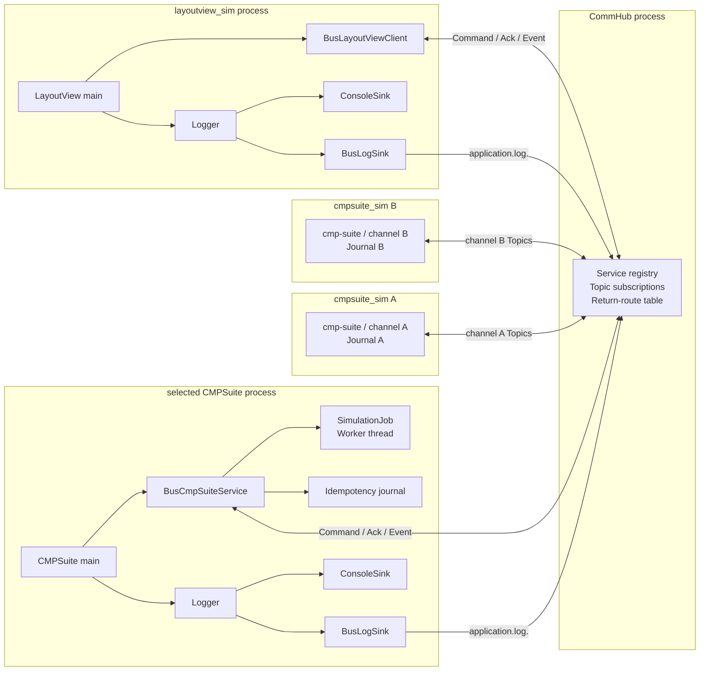
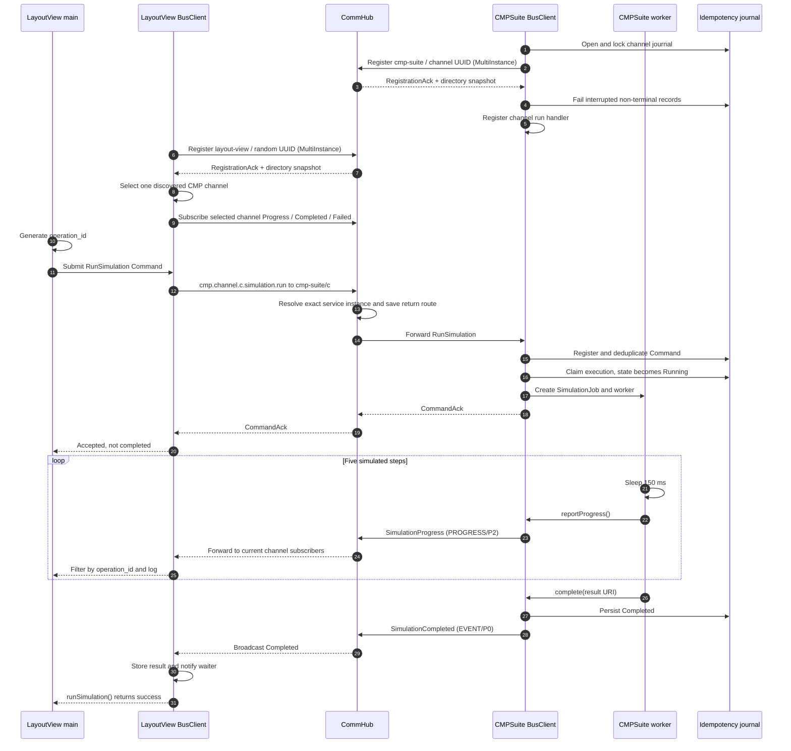
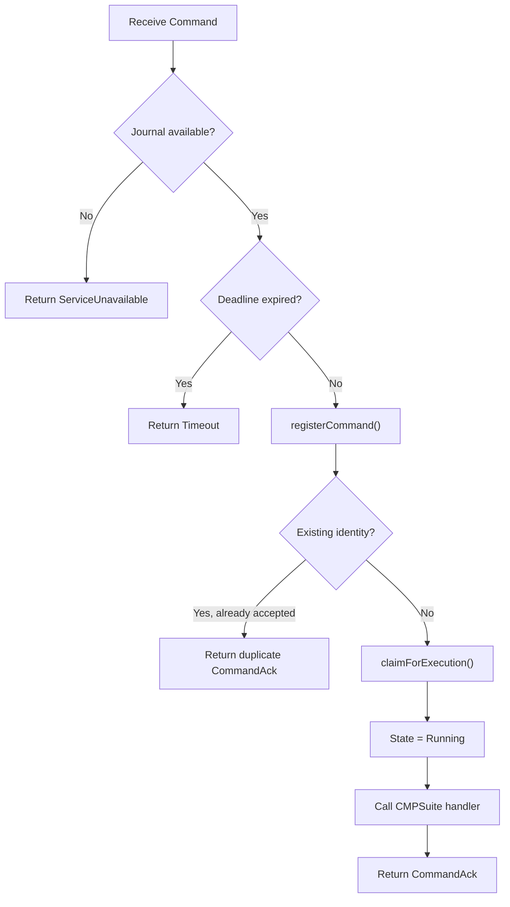
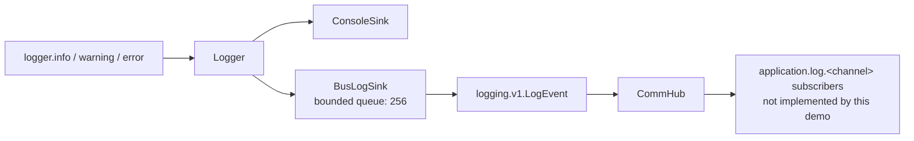
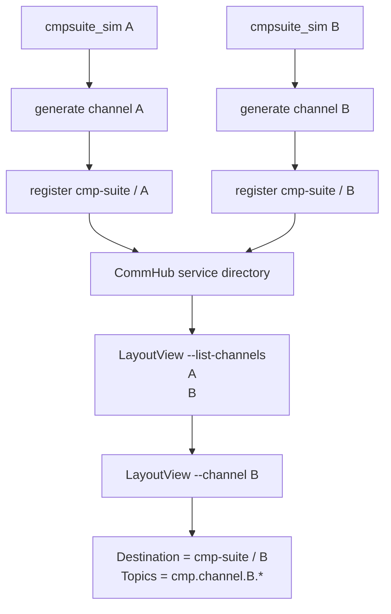

# LayoutView and CMPSuite communication

This document describes the current communication path between
`layoutview_sim` and `cmpsuite_sim`. Both executables use the plain C++
interfaces in `simulation_app.h`; all IndustrialBus and Protobuf details stay
inside `bus_simulation_adapter.cpp`.

The processes never connect directly. Commands, acknowledgements, events,
service-directory updates, and bus-backed logs are routed through CommHub.
Every CMPSuite process owns a UUID `channel_id`; that value is both its
`instance_id` and the namespace used by its Topics.

## Architecture



The application-facing interfaces are:

- `LayoutViewClient`: connects, submits one simulation, and waits for its final
  outcome;
- `CmpSuiteService`: accepts simulation jobs and owns their worker threads;
- `SimulationJob`: reports progress and publishes exactly one terminal result;
- `Logger` and `LogSink`: distribute diagnostic records independently of the
  business protocol.

## Topics and message roles

For channel UUID `<c>`, the owned Topics are:

| Topic | Protobuf payload | Wire semantics | Direction | Meaning |
|---|---|---|---|---|
| `cmp.channel.<c>.simulation.run` | `RunSimulation` | `COMMAND/P1` | LayoutView to exact CMPSuite | Submit a durable, idempotent simulation Command |
| `cmp.channel.<c>.simulation.progress` | `SimulationProgress` | `PROGRESS/P2` | CMPSuite to channel subscribers | Report non-terminal progress |
| `cmp.channel.<c>.simulation.completed` | `SimulationCompleted` | `EVENT/P0` | CMPSuite to channel subscribers | Report a successful terminal result |
| `cmp.channel.<c>.simulation.failed` | `SimulationFailed` | `EVENT/P0` | CMPSuite to channel subscribers | Report a failed terminal result |
| `application.log.<c>` | `LogEvent` | `LOG/P2` for warning/error, `LOG/P3` for info/debug | Either channel participant to subscribers | Publish diagnostic logs |

`CommandAck` is the standard reply type for the run Topic. It means the
Command was durably accepted and assigned to an owner. It does **not** mean the
simulation completed.

## End-to-end sequence



## 1. CMPSuite startup

`cmpsuite_sim` creates a console Logger and a `CmpSuiteService`, then calls
`start()` with the simulated algorithm callback.

The bus-backed service performs these operations in order:

1. uses `--channel UUID`, or generates a UUID and prints it;
2. opens and exclusively locks the channel's append-only journal;
3. registers `cmp-suite/<channel>` in `MultiInstance` mode;
4. marks journal records left non-terminal by a previous process as
   `Failed/OwnerUnavailable`;
5. attaches an asynchronous channel `BusLogSink` to the Logger;
6. registers the channel-specific run Command handler;
7. reports the channel and journal path as ready.

The journal is supplied to `BusClient`, so Command acceptance and duplicate
detection happen before the application callback starts.

## 2. LayoutView startup and subscriptions

`layoutview_sim --list-channels` registers as a unique `layout-view` instance,
reads the registration snapshot maintained by the runtime, filters live
`cmp-suite` instances whose instance ID is a UUID, sorts them, and exits.

`layoutview_sim --channel UUID` fixes that process to exactly one channel. It
does not fall back to another CMPSuite if the selected owner is unavailable.

For each `runSimulation()` call, LayoutView installs subscriptions for Progress,
Completed, and Failed **before** sending the Command. This ordering prevents a
fast CMPSuite operation from publishing a final event before LayoutView is
ready to receive it.

The three subscription handles remain alive until `runSimulation()` returns.
Each callback also checks `operation_id`, because multiple operations may still
share one channel Topic.

## 3. Command construction

LayoutView generates a UUID v4 `operation_id` and creates a `RunSimulation`
payload containing:

- a simulated input `DataRef` with an OASIS file URI;
- an immutable, read-only access mode;
- the requested step count in `parameters["steps"]`.

The accompanying Command options are:

```text
destination_service  = cmp-suite
destination_instance = <channel UUID>
topic                = cmp.channel.<channel UUID>.simulation.run
operation_id        = generated UUID
idempotency_key     = layout-view-<operation_id>
accept_timeout      = 5 seconds
```

The demo exchanges URIs only. It does not create the referenced OASIS input or
result files.

## 4. CommHub routing

The sending BusClient serializes `RunSimulation` and places it in an Envelope
containing the message ID, correlation ID, operation ID, destination, Topic,
payload type, idempotency key, and absolute deadline.

Every new Envelope also carries its canonical numeric priority and the reserved
`industrial_bus.message_class` header. CommHub accepts a valid legacy Envelope
without this header by deriving a safe class and effective priority from its
MessageType and payload role.

CommHub does not parse or execute CMP business data. It:

1. validates the authenticated LayoutView session;
2. rejects missing or expired Command deadlines;
3. resolves exactly `cmp-suite/<channel>`; it never chooses another instance;
4. stores a return route keyed by the Command message ID;
5. forwards the Envelope to that instance.

The saved return route allows the subsequent `CommandAck` or error reply to be
sent back to the correct LayoutView session.

CommHub queues traffic independently per destination. Progress for the same
operation is coalesced before overflow handling. A full queue evicts eligible
lower-value logs/progress/events first; otherwise P2/P3 is dropped, P1 is
rejected with resource exhaustion, and P0 disconnects only the slow consumer.
The same broadcast is still evaluated for every healthy subscriber.

This flow deliberately does not add message retries or status-query
compensation. A frame popped for a transport send that fails is not replayed;
finite retry and state-query recovery belong to a separate change.

## 5. Durable acceptance and duplicate handling

Before calling the CMPSuite application handler, the receiving BusClient uses
this journal identity:

```text
source_service + topic + idempotency_key
```

For this demo it is normally:

```text
layout-view + cmp.channel.<channel>.simulation.run + layout-view-<operation_id>
```



For a new Command, the CMPSuite handler parses `steps`, creates a
`BusSimulationJob`, starts a worker thread, and returns. Only then does the
BusClient send `CommandAck` with:

- `operation_id`;
- `owner_service` and `owner_instance`;
- the duplicate flag;
- the current operation state.

LayoutView waits up to six seconds for this Ack. After receiving it, LayoutView
continues waiting for a terminal Event using the application timeout, which is
15 seconds by default.

## 6. Progress events

The simulated worker executes the requested number of steps. The default is
five; every step sleeps for 150 ms and calls `reportProgress()`.

`BusSimulationJob` creates `SimulationProgress` with:

- the operation ID;
- stage `polishing`, or `finishing` for the last step;
- `current / total` as a value between zero and one;
- a human-readable step message.

CommHub forwards the Event only to current subscribers of the channel-specific
progress Topic. If there are no subscribers, the target set is empty and the
Event is not retained. LayoutView ignores events belonging to other
operation IDs and prints matching progress through its Logger.

Progress is best effort: it is not written to the idempotency journal and is
not replayed by this demo.

## 7. Completion and failure

`BusSimulationJob` uses an atomic terminal flag, so only the first call to
`complete()` or `fail()` can produce a terminal result.

On success, CMPSuite:

1. persists `Completed` in the journal;
2. builds a `SimulationCompleted` Event containing a result `DataRef`;
3. publishes the Event to the channel's completed Topic.

LayoutView's Completed callback stores the result URI, sets the shared outcome
to successful, and wakes the thread waiting on a condition variable.

On failure, CMPSuite persists `Failed` with an Error and publishes
`SimulationFailed`. LayoutView stores the error message and wakes the same
waiter. If neither terminal Event arrives before the LayoutView timeout,
`runSimulation()` fails with a timeout.

Persisting Completed before publishing the final Event protects the service's
terminal state. The current demo does not yet provide a status-query recovery
path if the final Event itself is lost.

## 8. Logger and BusLogSink side channel

Diagnostic logging is independent of Command and Event control flow.



The BusLogSink:

- copies LogRecords into a 256-entry queue;
- drops the oldest queued record if the queue is full;
- publishes asynchronously on a dedicated worker thread;
- reuses the application's existing BusClient;
- holds only a weak BusClient reference to avoid a reference cycle;
- never reports a bus-log failure through the same Logger, preventing recursion.

The current implementation publishes `LogEvent` on the ordinary Event Topic
`application.log.<channel>`. With no LogCollector subscriber, ConsoleSink
output remains visible but the bus log is neither forwarded nor persisted.

## 9. Opening CMPSuite more than once

Two launches without `--channel` generate different UUIDs and journals, so
both are valid online instances:



The same logical channel may have only one live owner:

- same channel plus the default journal: the second process normally fails the
  journal's exclusive file lock;
- same channel plus two different custom journals: the files do not conflict,
  but CommHub rejects the duplicate service/instance registration;
- different channels plus the same custom journal: unsupported, because one
  journal must not mix channel histories;
- restart after the old owner exits: reuse both its channel and journal. The
  startup recovery keeps terminal records and durably fails Created, Running,
  or Cancelling records with `OwnerUnavailable`.

Recovery updates local durable state only. Commands are not replayed, and the
demo does not publish offline failure Events for recovered operations. A
LayoutView that was waiting during a crash therefore times out; a production
version needs an operation-status query to retrieve the recovered terminal
state.

Service-directory removal is propagated on clean disconnect and after an
expired heartbeat lease. Because automatic client reconnection is not yet
implemented, a process that loses CommHub must be restarted.

## 10. Shutdown and `--once`

Without `--once`, CMPSuite waits until SIGINT or SIGTERM. With `--once`, the
main loop exits after the first worker finishes its handler. It does not mean
"run one process" or "allow one channel"; it is only a demo lifecycle switch.

Shutdown proceeds in this order:

1. cancel the Command handler so no new jobs can be accepted;
2. mark the service as stopping;
3. join all simulation workers;
4. remove and drain BusLogSink;
5. shut down BusClient;
6. release the journal.

LayoutView similarly removes and drains its BusLogSink before shutting down its
BusClient.

This order prevents worker threads or asynchronous log delivery from using a
BusClient after it has been closed.

## Source map

- Application entry points: `layoutview_sim.cpp`, `cmpsuite_sim.cpp`
- Plain C++ facade: `simulation_app.h`
- Bus-backed implementation and BusLogSink: `bus_simulation_adapter.cpp`
- Typed Topic catalog: `simulation_topics.h`
- Business schemas: `protocol/proto/cmp.proto`
- Log schema: `protocol/proto/logging.proto`
- Command acceptance and idempotency: `client/src/bus_client.cpp`
- CommHub routing: `commhub/src/message_router.cpp`
