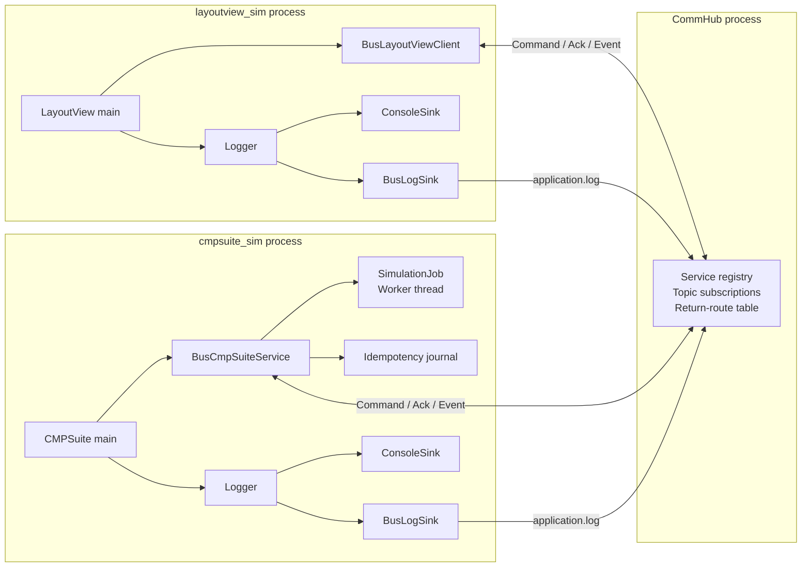
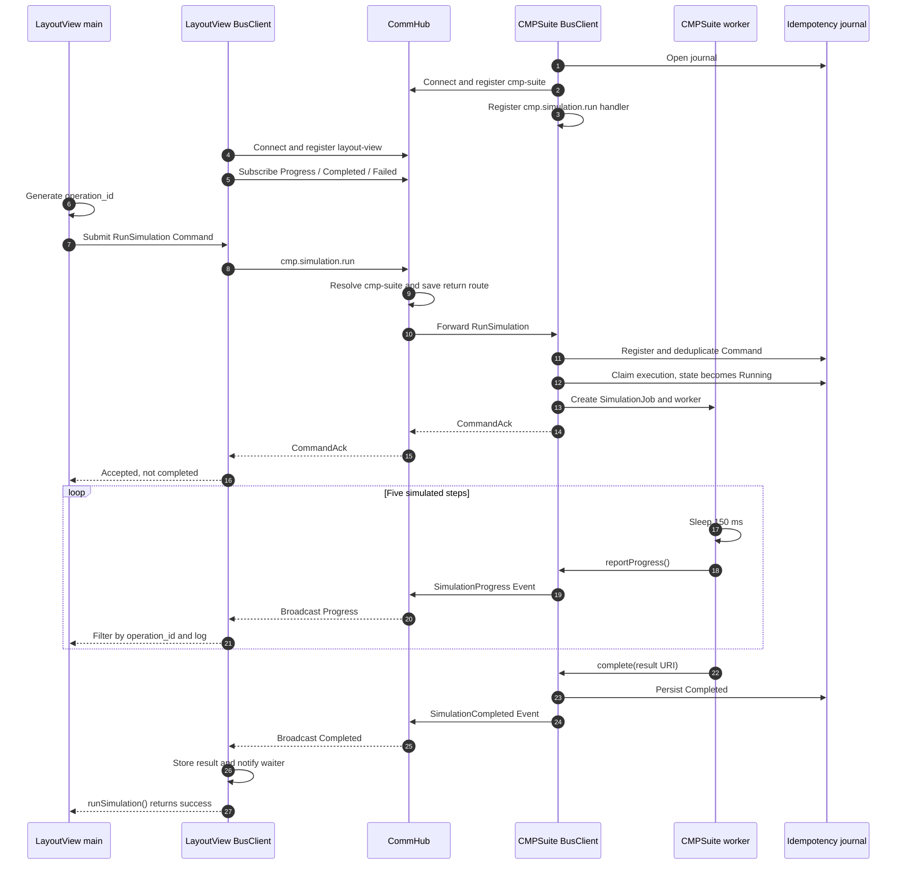
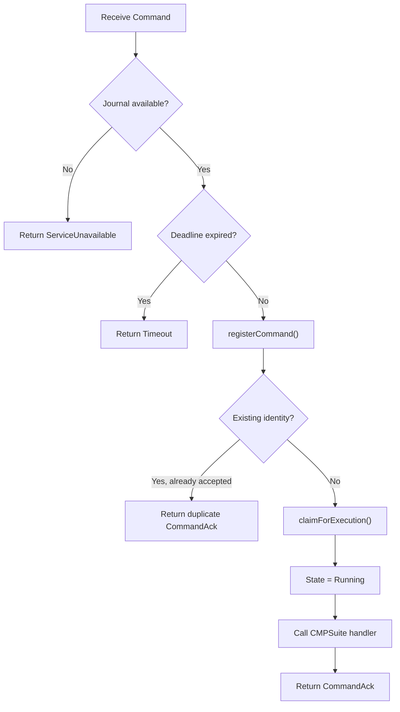
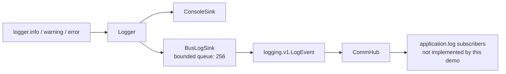

# LayoutView and CMPSuite communication

This document describes the current communication path between
`layoutview_sim` and `cmpsuite_sim`. Both executables use the plain C++
interfaces in `simulation_app.h`; all IndustrialBus and Protobuf details stay
inside `bus_simulation_adapter.cpp`.

The two processes never connect directly. Commands, acknowledgements, events,
and bus-backed logs are routed through CommHub.

## Architecture



The application-facing interfaces are:

- `LayoutViewClient`: connects, submits one simulation, and waits for its final
  outcome;
- `CmpSuiteService`: accepts simulation jobs and owns their worker threads;
- `SimulationJob`: reports progress and publishes exactly one terminal result;
- `Logger` and `LogSink`: distribute diagnostic records independently of the
  business protocol.

## Topics and message roles

| Topic | Protobuf payload | Direction | Meaning |
|---|---|---|---|
| `cmp.simulation.run` | `RunSimulation` | LayoutView to CMPSuite | Submit a durable, idempotent simulation Command |
| `cmp.simulation.progress` | `SimulationProgress` | CMPSuite to subscribers | Report non-terminal progress |
| `cmp.simulation.completed` | `SimulationCompleted` | CMPSuite to subscribers | Report a successful terminal result |
| `cmp.simulation.failed` | `SimulationFailed` | CMPSuite to subscribers | Report a failed terminal result |
| `application.log` | `LogEvent` | Either application to subscribers | Publish best-effort diagnostic logs |

`CommandAck` is the standard reply type for `cmp.simulation.run`. It means the
Command was durably accepted and assigned to an owner. It does **not** mean the
simulation completed.

## End-to-end sequence



## 1. CMPSuite startup

`cmpsuite_sim` creates a console Logger and a `CmpSuiteService`, then calls
`start()` with the simulated algorithm callback.

The bus-backed service performs these operations in order:

1. opens the append-only idempotency journal;
2. connects to CommHub with service name `cmp-suite`;
3. attaches an asynchronous `BusLogSink` to the Logger;
4. registers the `cmp.simulation.run` Command handler;
5. reports that the service is ready.

The journal is supplied to `BusClient`, so Command acceptance and duplicate
detection happen before the application callback starts.

## 2. LayoutView startup and subscriptions

`layoutview_sim` creates a Logger and `LayoutViewClient`, then connects with
service name `layout-view`.

For each `runSimulation()` call, LayoutView installs subscriptions for Progress,
Completed, and Failed **before** sending the Command. This ordering prevents a
fast CMPSuite operation from publishing a final event before LayoutView is
ready to receive it.

The three subscription handles remain alive until `runSimulation()` returns.
Each callback checks `operation_id`, because the Topics are shared by every
concurrent simulation.

## 3. Command construction

LayoutView generates a UUID v4 `operation_id` and creates a `RunSimulation`
payload containing:

- a simulated input `DataRef` with an OASIS file URI;
- an immutable, read-only access mode;
- the requested step count in `parameters["steps"]`.

The accompanying Command options are:

```text
destination_service = cmp-suite
topic               = cmp.simulation.run
operation_id        = generated UUID
idempotency_key     = layout-view-<operation_id>
accept_timeout      = 5 seconds
```

The demo exchanges URIs only. It does not create the referenced OASIS input or
result files.

## 4. CommHub routing

The sending BusClient serializes `RunSimulation` and places it in an Envelope
containing the message ID, correlation ID, operation ID, destination, Topic,
payload type, idempotency key, and absolute deadline.

CommHub does not parse or execute CMP business data. It:

1. validates the authenticated LayoutView session;
2. rejects missing or expired Command deadlines;
3. resolves the registered `cmp-suite` service instance;
4. stores a return route keyed by the Command message ID;
5. forwards the Envelope to that instance.

The saved return route allows the subsequent `CommandAck` or error reply to be
sent back to the correct LayoutView session.

## 5. Durable acceptance and duplicate handling

Before calling the CMPSuite application handler, the receiving BusClient uses
this journal identity:

```text
source_service + topic + idempotency_key
```

For this demo it is normally:

```text
layout-view + cmp.simulation.run + layout-view-<operation_id>
```



For a new Command, the CMPSuite handler parses `steps`, creates a
`BusSimulationJob`, starts a worker thread, and returns. Only then does the
BusClient send `CommandAck` with:

- `operation_id`;
- `owner_service` and `owner_instance`;
- the duplicate flag;
- the current operation state.

LayoutView waits up to six seconds for this Ack. After receiving it, LayoutView
continues waiting for a terminal Event using the application timeout, which is
15 seconds by default.

## 6. Progress events

The simulated worker executes the requested number of steps. The default is
five; every step sleeps for 150 ms and calls `reportProgress()`.

`BusSimulationJob` creates `SimulationProgress` with:

- the operation ID;
- stage `polishing`, or `finishing` for the last step;
- `current / total` as a value between zero and one;
- a human-readable step message.

CommHub broadcasts the Event to current subscribers of
`cmp.simulation.progress`. LayoutView ignores events belonging to other
operation IDs and prints matching progress through its Logger.

Progress is best effort: it is not written to the idempotency journal and is
not replayed by this demo.

## 7. Completion and failure

`BusSimulationJob` uses an atomic terminal flag, so only the first call to
`complete()` or `fail()` can produce a terminal result.

On success, CMPSuite:

1. persists `Completed` in the journal;
2. builds a `SimulationCompleted` Event containing a result `DataRef`;
3. publishes the Event to `cmp.simulation.completed`.

LayoutView's Completed callback stores the result URI, sets the shared outcome
to successful, and wakes the thread waiting on a condition variable.

On failure, CMPSuite persists `Failed` with an Error and publishes
`SimulationFailed`. LayoutView stores the error message and wakes the same
waiter. If neither terminal Event arrives before the LayoutView timeout,
`runSimulation()` fails with a timeout.

Persisting Completed before publishing the final Event protects the service's
terminal state. The current demo does not yet provide a status-query recovery
path if the final Event itself is lost.

## 8. Logger and BusLogSink side channel

Diagnostic logging is independent of Command and Event control flow.



The BusLogSink:

- copies LogRecords into a 256-entry queue;
- drops the oldest queued record if the queue is full;
- publishes asynchronously on a dedicated worker thread;
- reuses the application's existing BusClient;
- holds only a weak BusClient reference to avoid a reference cycle;
- never reports a bus-log failure through the same Logger, preventing recursion.

The current implementation publishes `LogEvent` on the ordinary Event Topic
`application.log`. With no LogCollector subscriber, ConsoleSink output remains
visible but the bus log is not persisted.

## 9. Shutdown and `--once`

Without `--once`, CMPSuite waits until SIGINT or SIGTERM. With `--once`, the
main loop exits after the first worker finishes its handler.

Shutdown proceeds in this order:

1. cancel the Command handler so no new jobs can be accepted;
2. mark the service as stopping;
3. join all simulation workers;
4. remove and drain BusLogSink;
5. shut down BusClient;
6. release the journal.

LayoutView similarly removes and drains its BusLogSink before shutting down its
BusClient.

This order prevents worker threads or asynchronous log delivery from using a
BusClient after it has been closed.

## Source map

- Application entry points: `layoutview_sim.cpp`, `cmpsuite_sim.cpp`
- Plain C++ facade: `simulation_app.h`
- Bus-backed implementation and BusLogSink: `bus_simulation_adapter.cpp`
- Typed Topic catalog: `simulation_topics.h`
- Business schemas: `protocol/proto/cmp.proto`
- Log schema: `protocol/proto/logging.proto`
- Command acceptance and idempotency: `client/src/bus_client.cpp`
- CommHub routing: `commhub/src/message_router.cpp`
