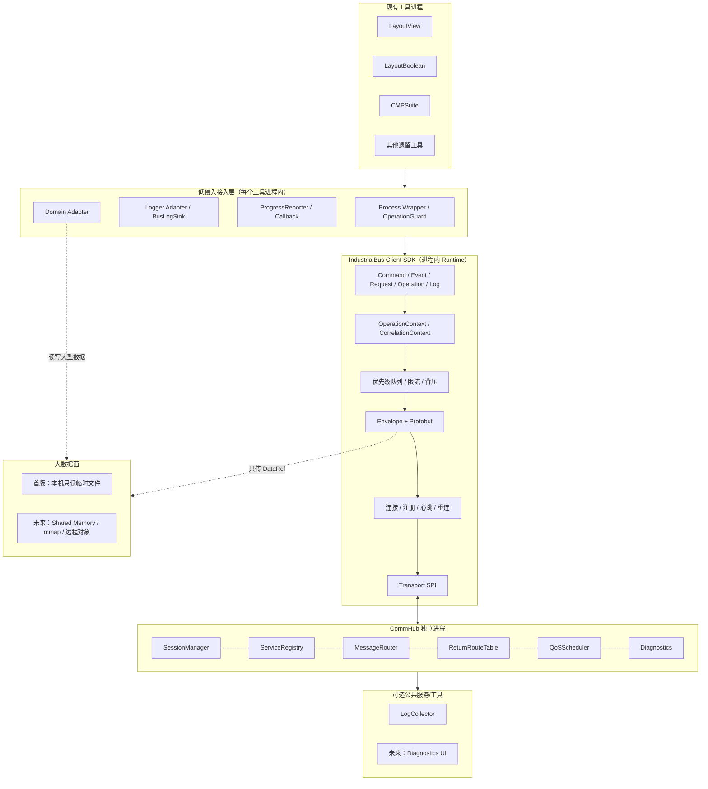
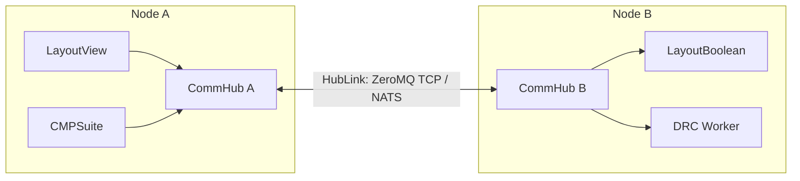
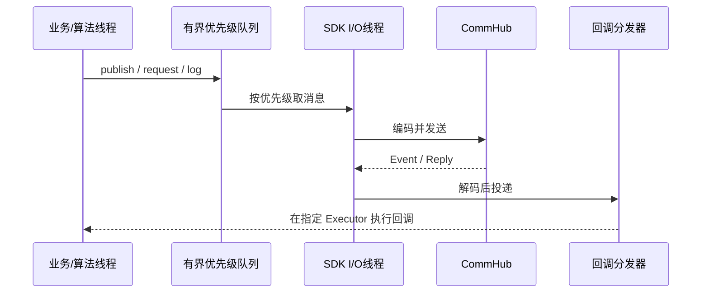
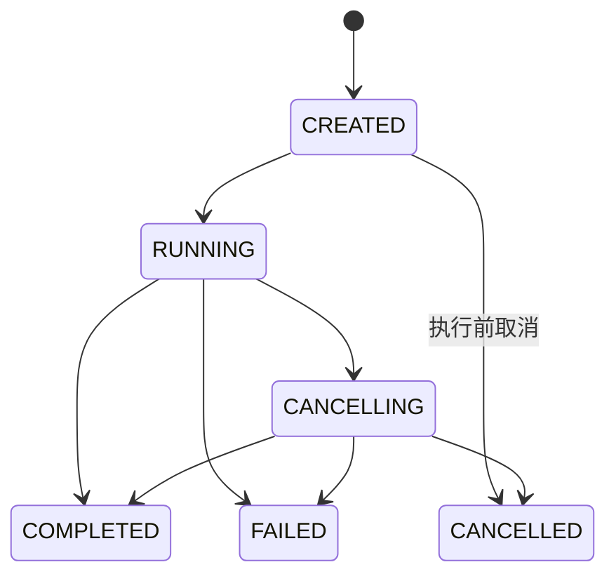
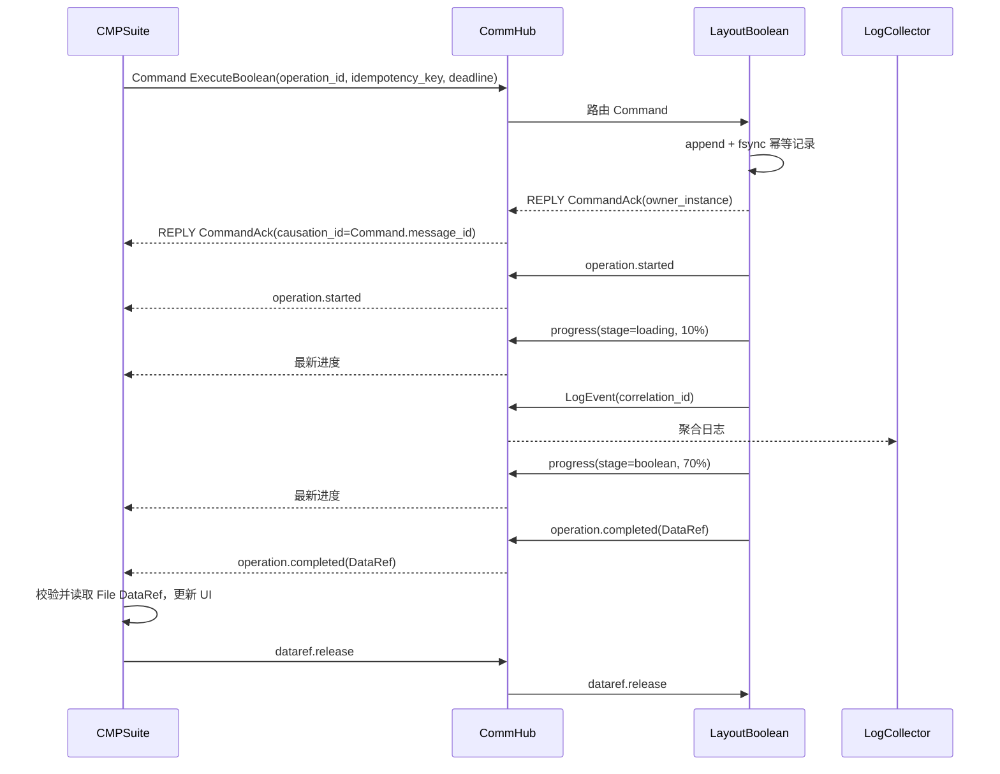

# IndustrialBus 基础通信组件开发设计文档

> 文档状态：设计基线（已完成首版关键决策评审）
> 文档版本：0.2
> 适用范围：LayoutView、LayoutBoolean、CMPSuite 及后续工业软件工具
> 参考实现语言：C++17
> 首版运行环境：Linux x86_64、GCC 9+、libstdc++、Release 构建
> 构建系统：CMake；业务应用统一使用 Qt 5.13，但 IndustrialBus 首版完全不依赖 Qt

## 1. 文档目的

本文档定义一套面向工业桌面软件和算法工具的通用通信基础组件。目标是在不大规模修改现有业务与算法代码的前提下，为不同进程提供统一的：

- Command、Event、Request/Reply 通信；
- 长任务生命周期、进度和取消；
- 结构化错误；
- 日志聚合与调用链关联；
- 服务注册、心跳、断线检测和自动重连；
- 大数据引用传递；
- 本机进程通信；
- 为未来 Windows 和跨节点部署保留清晰的扩展边界。

文档同时给出模块划分、公共 API、协议模型、进程与线程模型、启动流程、可靠性策略、安全要求、测试方案和实施路线，可作为编码、评审和验收的基础。

## 2. 背景与问题

当前系统包含多个相互独立的工具进程，例如：

- `LayoutView`：版图查看、选择区域、图层和视图交互；
- `LayoutBoolean`：执行版图 Boolean 等几何计算；
- `CMPSuite`：发起和编排 CMP 任务、展示结果；
- 后续可能加入 DRC、OPC、仿真、数据转换和批处理工具。

如果各工具直接点对点连接，会逐渐出现以下问题：

- 工具之间形成网状依赖；
- 每个工具重复实现连接、超时、序列化和重连；
- 消息格式和错误格式不统一；
- 日志、进度与业务任务难以关联；
- 大数据被错误地放入消息通道，产生大量复制；
- 本地通信实现无法平滑扩展到跨节点；
- 遗留算法需要直接依赖 IPC，改造成本和维护成本过高。

因此需要一个独立、稳定、可复用的 `IndustrialBus` 基础组件。

## 3. 设计目标

### 3.1 核心目标

1. **低侵入接入**：现有算法可以从零修改、入口包装、日志适配逐步升级到精确进度。
2. **业务与传输解耦**：业务代码不依赖 ZeroMQ、Named Pipe、TCP 或 NATS。
3. **本机优先、网络可扩展**：首版满足本机进程通信，并保留未来跨节点路由的扩展边界。
4. **统一语义**：Command、Event、Request、Reply、Progress、Error、Log 和 DataRef 有明确边界。
5. **异步非阻塞**：日志、进度和普通发布不得阻塞算法线程。
6. **可观测**：所有消息可通过 `correlation_id` 和 `message_id` 追踪；长任务相关消息还可通过 `operation_id` 追踪。
7. **可演进**：协议字段可前后兼容，底层 Transport 可替换。
8. **故障隔离**：单个工具崩溃不影响其他工具；CommHub 可自动重启和恢复连接。

### 3.2 非目标

首版不计划实现：

- 大型几何数据的完整分布式存储系统；
- 通用工作流引擎；
- 强一致分布式事务；
- 跨广域网的自动服务编排；
- 对所有消息提供 Exactly-Once；
- 将 CommHub 作为业务状态数据库；
- Windows Transport 和 Windows 启动/发现机制；
- HubLink、NATS、跨节点路由和跨节点安全；
- Shared Memory、mmap、远程对象或流式 DataRef；
- Qt Integration 库或任何 Qt 运行时依赖；
- 合规意义上的集中可靠审计总线。

## 4. 核心设计原则

### 4.1 依赖方向

```text
Algorithm
    ↓
Application / Integration Adapter
    ↓
IndustrialBus Client SDK
    ↓
Protocol + Transport
    ↓
CommHub
```

算法层不得包含：

```cpp
zmq_send(...);
bus.publish(...);
nats_publish(...);
```

算法层最多依赖通用的日志、Callback 或 `ProgressReporter` 抽象。

### 4.2 控制面与数据面分离

- 控制面：Protobuf 小消息，承载命令、状态、错误、日志、进度和 DataRef。
- 首版数据面：当前用户私有目录中的不可变只读文件；Shared Memory、mmap、共享文件系统和远程数据服务留作后续扩展。
- 不允许将几十 MB 或 GB 的 geometry、image、height map 直接放入控制消息。

### 4.3 CommHub 保持轻量

CommHub 只负责：

- 连接和会话；
- 服务注册；
- 消息路由；
- Pub/Sub；
- Request/Reply 关联；
- 心跳和断线；
- QoS 调度；
- 诊断信息。

Boolean、CMP、DRC 等业务任务状态必须由对应业务进程管理。

## 5. 总体架构



## 6. 部署模型

### 6.1 单节点模式

用户只启动任意一个工具，SDK 自动拉起后台 CommHub：

```text
layout-view
    ├── IndustrialBus Client Runtime（进程内线程）
    └── 自动启动 commhub（独立进程）

layout-boolean
    └── 直接连接已经存在的 commhub
```

首版为每个 Linux UID 启动一个 CommHub 实例，使用 `$XDG_RUNTIME_DIR/industrial-bus/` 发现和认证。不同用户之间完全隔离。

### 6.2 未来跨节点模式（非首版）



未来每个应用仍只连接本机 CommHub，由 Hub 判断目标服务在本机还是远端。首版不实现 HubLink、远程服务目录或跨节点 DataRef。

## 7. 进程和线程模型

### 7.1 Client Runtime

`IndustrialBus Client Runtime` 是链接到工具进程内部的 SDK，不是独立进程。每个工具进程只创建一个 Runtime。

推荐线程组成：

- 1 个 Transport I/O 线程；
- 1 个轻量调度器；
- 0～N 个回调线程，或者使用调用方提供的 Executor；
- 回调不得运行在 Transport I/O 线程；
- SDK 提供默认回调执行器，并允许应用注入通用 `IExecutor`；
- Qt UI 线程投递由 LayoutView、LayoutBoolean、CMPSuite 各自的应用 Adapter 实现，IndustrialBus 不包含 Qt 头文件、不链接 Qt；
- ZeroMQ Socket 只能由其所属 I/O 线程操作。



### 7.2 Runtime、Subscription 与回调生命周期

- 每个进程只允许一个共享 Client Runtime；重复 `connect()` 复用该 Runtime；
- `Subscription` 是只移动的 RAII 对象，析构即取消订阅；
- 取消后不再开始新的回调，已开始的回调允许执行完成；
- 回调默认在 SDK 回调线程池执行，也可投递到应用提供的 `IExecutor`；
- 应用负责自定义 Executor 和回调目标的生命周期；Qt 应用应在自己的 Adapter 中绑定 `QObject` 生命周期；
- SDK 捕获、记录并隔离回调异常，异常不得终止 I/O 线程；
- `shutdown()` 依次停止接受新消息、取消订阅、结束 Pending Request、限时刷新关键队列并关闭 Transport；超时后直接关闭，不无限等待；
- 应用不得依赖全局静态对象的析构顺序关闭 Runtime。

### 7.3 CommHub

CommHub 是独立进程。建议内部采用：

- 1 个网络/ZeroMQ I/O 主线程；
- 1 个路由调度线程，首版也可与 I/O 线程合并；
- 可选的诊断与持久化线程；
- 不在 I/O 线程执行任何业务算法。

## 8. 启动、单例与退出

### 8.1 自动启动

`BusClient::connect()` 内部执行：

1. 校验 `$XDG_RUNTIME_DIR` 存在、属于当前 UID 且权限安全；不安全或不可用时明确失败，不回退到公共 `/tmp`；
2. 在 `$XDG_RUNTIME_DIR/industrial-bus/` 下创建权限为 `0700` 的运行目录；
3. 读取并校验 `endpoint.json` 和 `auth.token`：必须是当前 UID 所有、权限 `0600`、不是符号链接；
4. 尝试连接 `ipc://$XDG_RUNTIME_DIR/industrial-bus/commhub.sock`；
5. 连接失败时对 `commhub.lock` 获取 `flock` 独占锁，获得锁后再次检查 Endpoint；
6. 确认不存在有效 CommHub 后启动 `commhub`；启动进程把锁文件描述符安全传递给 Hub，Hub 在整个生命周期内持续持锁，避免父进程释放锁与子进程重新加锁之间出现竞争窗口；
7. Hub 生成新的 instance ID 和安全随机认证 Token，以 `O_NOFOLLOW` 和仅当前 UID 可读写的方式创建控制文件，并原子发布 `endpoint.json`；
8. 其他进程等待 Endpoint 就绪；
9. 完成身份验证、协议握手、服务注册和订阅恢复。

运行目录内容：

```text
$XDG_RUNTIME_DIR/industrial-bus/
├── commhub.sock
├── commhub.lock
├── endpoint.json   # endpoint、PID、Hub instance ID、协议版本、启动时间
└── auth.token      # 安全随机 Token
```

只有持有启动锁，并通过 Endpoint 握手失败、instance ID 校验等确认旧 Hub 已失效后才能清理遗留 socket；不得只依据可能复用的 PID 判断。实现还必须在启动时校验 Unix Domain Socket 路径长度。Hub 退出时只清理由自身创建且 instance ID 匹配的文件。

### 8.2 启动模式

```cpp
enum class HubStartupMode {
    AutoStart,
    ConnectOnly,
    EmbeddedForTest
};
```

默认采用 `AutoStart`。

### 8.3 退出策略

- 有客户端连接时 CommHub 持续运行；
- 客户端数变为 0 时启动 60 秒空闲计时；
- 计时期间有新客户端连接则取消退出；
- 计时到期仍无客户端则正常退出；
- CommHub 异常退出后，客户端竞争启动锁并自动重启。

## 9. 代码模块划分

```text
industrial-bus/
├── CMakeLists.txt
├── cmake/
│   └── IndustrialBusConfig.cmake
├── api/
│   ├── include/industrial_bus/
│   │   ├── bus_client.h
│   │   ├── client_options.h
│   │   ├── topic.h
│   │   ├── subscription.h
│   │   ├── executor.h
│   │   ├── operation.h
│   │   ├── error.h
│   │   ├── qos.h
│   │   └── data_ref.h
│   └── src/
├── protocol/
│   ├── proto/
│   │   ├── envelope.proto
│   │   ├── system.proto
│   │   ├── operation.proto
│   │   ├── logging.proto
│   │   ├── layout.proto
│   │   └── cmp.proto
│   ├── generated/
│   └── src/protobuf_codec.cpp
├── client/
│   ├── connection_manager.cpp
│   ├── hub_bootstrapper.cpp
│   ├── request_manager.cpp
│   ├── subscription_registry.cpp
│   ├── event_dispatcher.cpp
│   ├── outbound_queue.cpp
│   ├── progress_throttle.cpp
│   └── operation_context.cpp
├── transport/
│   ├── include/industrial_bus/transport/transport.h
│   ├── zeromq/
│   ├── future/                 # 非首版：Windows、NATS 等实现
│   └── loopback/
├── integration/
│   ├── operation_guard/
│   ├── logging/
│   ├── progress/
│   └── process_wrapper/
├── commhub/
│   ├── main.cpp
│   ├── session_manager.cpp
│   ├── service_registry.cpp
│   ├── message_router.cpp
│   ├── return_route_table.cpp
│   ├── qos_scheduler.cpp
│   └── diagnostics.cpp
├── tools/
│   └── protocol-inspector/
├── future/
│   ├── hub-link/
│   └── diagnostics-ui/
├── examples/
└── tests/
    ├── unit/
    ├── integration/
    ├── compatibility/
    ├── fault/
    └── stress/
```

### 9.1 模块依赖约束

```text
application
  ├── industrial-bus-api
  └── industrial-bus-integration（可选）

industrial-bus-client
  ├── industrial-bus-core
  ├── industrial-bus-protocol
  └── industrial-bus-transport-spi

transport implementations
  └── industrial-bus-transport-spi

commhub
  ├── industrial-bus-core
  ├── industrial-bus-protocol
  └── transport implementations
```

禁止 Transport 实现反向依赖 Client，也禁止业务 schema 反向依赖应用代码。

IndustrialBus 首版所有目标均为纯 C++17，不调用 `find_package(Qt5)`。Qt 5.13 Release 只属于三个业务应用，应用可在自身代码中实现 Qt Executor Adapter。

## 10. 公共 C++ API

### 10.1 BusClient

公共 API 使用门面和 PImpl，避免将 ZeroMQ、线程和 Protobuf Runtime 的实现细节暴露给业务。

```cpp
class BusClient {
public:
    static Result<std::shared_ptr<BusClient>>
    connect(const ClientOptions& options);

    template<class Event>
    Result<void> publish(
        EventTopic<Event> topic,
        const Event& event,
        PublishOptions options = {});

    template<class Event, class Handler>
    Subscription subscribe(
        EventTopic<Event> topic,
        Handler&& handler,
        std::shared_ptr<IExecutor> executor = {});

    template<class Command>
    Future<Result<CommandAck>> command(
        Destination destination,
        CommandTopic<Command, CommandAck> topic,
        const Command& command,
        CommandOptions options = {});

    template<class Request, class Response>
    Future<Result<Response>> request(
        Destination destination,
        RequestTopic<Request, Response> topic,
        const Request& request,
        Duration timeout);

    Result<void> shutdown(Duration timeout);
    ConnectionState connectionState() const;
    ServiceSnapshot services() const;

private:
    class Impl;
    std::unique_ptr<Impl> impl_;
};

class IExecutor {
public:
    virtual ~IExecutor() = default;
    virtual void post(std::function<void()> task) = 0;
};

struct CommandOptions {
    std::string idempotency_key;
    Duration accept_timeout;
};
```

`command()` 返回的 Future 表示目标业务服务的接受结果，而不是只表示本地写队列成功。`idempotency_key` 必须非空，SDK 根据 `accept_timeout` 生成绝对 deadline。本地参数非法、未连接、编码失败或队列满时 Future 立即完成为错误；算法线程不等待网络。IndustrialBus 不提供 Qt Executor，Qt 应用在自己的 Adapter 中实现 `IExecutor`。

### 10.2 Transport SPI

```cpp
class IConnection {
public:
    virtual ~IConnection() = default;
    virtual Result<void> send(ByteView frame) = 0;
    virtual void setReceiveHandler(ReceiveHandler handler) = 0;
    virtual ConnectionState state() const = 0;
    virtual void close() = 0;
};

class IConnector {
public:
    virtual ~IConnector() = default;
    virtual Future<Result<std::shared_ptr<IConnection>>>
    connect(const Endpoint& endpoint) = 0;
};

class IListener {
public:
    virtual ~IListener() = default;
    virtual Result<void> listen(
        const Endpoint& endpoint,
        AcceptHandler handler) = 0;
};
```

`IConnection::send()` 成功只表示字节帧已被本地 Transport 接受，不表示 Hub 已路由或目标服务已处理。上层 Command/Request API 必须通过 Reply/Error 完成业务结果，不能把 Transport 返回值提升为远端确认。

### 10.3 Topic Catalog

禁止在业务代码中散落 Topic 字符串。Topic 类型必须表达消息方向；Command 和 Request 不能只绑定一个 payload 类型：

```cpp
namespace topics {

inline constexpr CommandTopic<ExecuteBoolean, CommandAck>
    kExecuteBoolean{
        "layout.boolean.execute",
        "industrial_bus.layout.v1.ExecuteBoolean",
        "industrial_bus.system.v1.CommandAck"};

inline constexpr EventTopic<BooleanProgress>
    kBooleanProgress{
        "layout.boolean.progress",
        "industrial_bus.layout.v1.BooleanProgress"};

inline constexpr EventTopic<BooleanCompleted>
    kBooleanCompleted{
        "layout.boolean.completed",
        "industrial_bus.layout.v1.BooleanCompleted"};

inline constexpr EventTopic<BooleanFailed>
    kBooleanFailed{
        "layout.boolean.failed",
        "industrial_bus.layout.v1.BooleanFailed"};

inline constexpr RequestTopic<GetOperationStatus, OperationStatus>
    kGetOperationStatus{
        "operation.get_status",
        "industrial_bus.operation.v1.GetOperationStatus",
        "industrial_bus.operation.v1.OperationStatus"};

} // namespace topics
```

## 11. 消息协议

### 11.1 Envelope

```protobuf
syntax = "proto3";

message MessageEnvelope {
  string message_id = 1;
  string correlation_id = 2;

  string source_node = 3;
  string source_service = 4;
  string source_instance = 5;

  string destination_node = 6;
  string destination_service = 7;
  string destination_instance = 8;

  string topic = 9;
  MessageType message_type = 10;

  int64 timestamp_unix_ns = 11;
  uint32 protocol_version = 12;
  uint32 schema_version = 13;

  uint32 priority = 14;
  uint32 hop_count = 15;
  uint32 max_hops = 16;

  map<string, string> headers = 17;
  bytes payload = 18;

  string operation_id = 19;
  string causation_id = 20;
  string payload_type = 21;
  int64 deadline_unix_ns = 22;
  PayloadRole payload_role = 23;
  string idempotency_key = 24;
}

enum MessageType {
  MESSAGE_TYPE_UNSPECIFIED = 0;
  COMMAND = 1;
  EVENT = 2;
  REQUEST = 3;
  REPLY = 4;
  PROGRESS = 5;
  ERROR = 6;
  LOG = 7;
  HEARTBEAT = 8;
  SYSTEM = 9;
}

enum PayloadRole {
  PAYLOAD_ROLE_UNSPECIFIED = 0;
  COMMAND_INPUT = 1;
  COMMAND_ACK = 2;
  REQUEST_INPUT = 3;
  RESPONSE_OUTPUT = 4;
  EVENT_FACT = 5;
  ERROR_DETAIL = 6;
  SYSTEM_PAYLOAD = 7;
}
```

### 11.2 标识符语义

| 字段 | 语义 |
|---|---|
| `message_id` | 每条消息唯一，用于去重和诊断 |
| `correlation_id` | 一次跨服务业务流程的统一关联 ID |
| `causation_id` | 直接触发本消息的上一条消息 ID；Reply 指向对应 Request 的 `message_id` |
| `operation_id` | 全局唯一的长任务 ID，提升到 Envelope；业务 payload 中如同时存在，值必须一致 |
| `payload_type` | Protobuf 完整类型名，用于 Topic 与 payload 类型校验 |
| `payload_role` | payload 在双向 Topic 中的角色，用于区分输入、成功响应、事件和错误 |
| `deadline_unix_ns` | Request/Command 的绝对截止时间；0 表示该消息类型不使用 deadline |
| `idempotency_key` | Command 的 SDK 级幂等键；所有 Command 必须非空，其他消息必须为空 |
| `instance_id` | 某个服务进程实例 ID，每次启动可变化 |
| `node_id` | 安装节点稳定 ID |

链路发起者创建 `correlation_id`，后续 Command、Reply、Event 和 Log 全程继承，不得用上一条 `message_id` 覆盖。每条派生消息使用 `causation_id` 指向直接原因。

Envelope 解码后、路由前必须统一验证：必填标识符非空且格式/长度满足 `ProtocolLimits`，时间戳与 deadline 合法，payload 不超过配置上限，`headers` 的数量、键和值长度受限且系统保留键只能由 SDK 写入，`hop_count <= max_hops`。具体上限集中定义并进入协议兼容测试，禁止各服务自行解释。

### 11.3 Topic 命名

统一采用：

```text
<domain>.<object>.<action-or-event>
```

示例：

```text
layout.selection.changed
layout.boolean.execute
layout.boolean.cancel
layout.boolean.started
layout.boolean.progress
layout.boolean.completed
layout.boolean.failed
cmp.simulation.run
system.service.connected
system.service.disconnected
log.layout-boolean.error
```

### 11.4 Topic 与业务 Schema 绑定

- Topic Catalog 是 Topic 的唯一注册源，业务代码不得手写 Topic 字符串；
- 类型绑定键为 `(topic, message_type, payload_role)`，每个键在一个业务 schema 主版本内只能绑定一个 Protobuf 完整类型名；
- `CommandTopic<Command, CommandAck>` 同时声明命令输入和 Accepted 输出，`RequestTopic<Request, Response>` 同时声明请求和成功响应，`EventTopic<Event>` 声明单向事实；标准 `Error` 由 Catalog 为允许失败的 Topic 统一登记；
- Hub 校验 Topic、MessageType、`payload_role`、`payload_type`、schema major 和 payload 大小，但不解析业务 payload；
- 兼容字段扩展沿用原 Topic 和 schema major；不兼容变更必须使用新命名空间和新 Topic，例如 `layout.boolean.v2.execute` 与 `industrial_bus.layout.v2.ExecuteBoolean`；
- `schema_version` 只表示业务 schema 主版本，不随兼容字段追加而递增；
- 未知 payload type 或不支持的 schema major 返回 `PROTOCOL_ERROR`；
- `protocol_version` 只描述 Envelope、握手和系统消息协议，与业务 schema 独立演进；
- Topic Catalog、生成代码和历史 `.proto` fixture 必须纳入兼容性 CI。

### 11.5 兼容性规则

Protobuf schema 必须遵守：

- 已发布字段编号不得复用；
- 删除字段后使用 `reserved`；
- 新字段必须有合理默认语义；
- 不修改字段类型表达不同含义；
- enum 新值只能追加；
- 接收方必须忽略未知字段；
- CI 中保存历史 schema，执行兼容性检查；
- 握手阶段交换支持的协议版本范围。

## 12. 消息语义

### 12.1 Command

Command 表示要求目标服务执行动作：

```text
layout.boolean.execute
layout.boolean.cancel
layout.view.highlight
cmp.simulation.run
```

要求：

- 必须有目标服务；
- 长任务必须携带 `operation_id`；
- 所有 Command 必须在 Envelope 携带非空 `idempotency_key`；同一业务意图的重试必须复用该值，新业务意图必须生成新值；
- 接收方先做幂等检查，再执行业务；
- 接收方必须在返回 Accepted 前完成幂等登记的 append + `fsync`，并且不得在持久化完成前启动业务执行；
- Accepted 表示目标服务已经承担任务，不表示任务最终成功；
- Accepted 使用 `REPLY + CommandAck` 承载，Rejected 使用 `REPLY + Error` 承载，二者都通过 `causation_id` 指向 Command，不新增 MessageType；
- 本地未连接、编码失败或队列满时返回本地错误；Hub 找不到目标服务时返回 `SERVICE_UNAVAILABLE`；
- Accepted 后连接中断不得自动重放 Command，恢复后使用 `operation.get_status` 查询；
- SDK 不提供绕过幂等登记的非持久化 Command 模式；不需要 Accepted/Operation 语义的瞬时通知应建模为 Event，而不是 Command。

标准接受响应：

```protobuf
message CommandAck {
  string operation_id = 1;
  string owner_service = 2;
  string owner_instance = 3;
  bool duplicate = 4;
  OperationState current_state = 5;
}
```

后续 Cancel 和状态查询使用 Ack 返回的 owner 信息精确寻址。重复命令返回同一 `operation_id`，并以 `duplicate=true` 表明命中了已有幂等记录。

### 12.2 Event

Event 表示已经发生的事实：

```text
layout.selection.changed
layout.boolean.completed
system.service.disconnected
```

Event 不应包含“请执行”的语义。

### 12.3 Request/Reply

用于短时查询：

```text
layout.get_selection
layout.get_current_document
operation.get_status
system.get_service_info
```

要求：

- Request 必须携带绝对 `deadline_unix_ns`；调用方以单调时钟管理本地等待；
- 调用方 SDK 是超时结果的唯一所有者，并维护 PendingRequestTable；
- Reply 继承 Request 的 `correlation_id`，并以 `causation_id` 指向 Request 的 `message_id`；
- Hub 只维护带 TTL 的返回路由，可拒绝已过期 Request，但不与客户端竞争产生 Timeout；
- 调用方超时后的迟到 Reply 被丢弃，并记录诊断指标；
- Hub 重启或连接代次变化时，未完成请求返回 `HUB_RESTARTED`；目标服务断开时返回 `SERVICE_UNAVAILABLE`；
- Request 只用于短查询；长任务统一使用 Command + Operation。

### 12.4 `ERROR` MessageType 边界

- `ERROR` 只承载标准 `Error` payload，并使用 `ERROR_DETAIL` role；
- Command 的 Rejected、Request 处理失败，以及 Hub 对 Command/Request 的路由或协议拒绝，统一使用 `REPLY + Error + ERROR_DETAIL`，并通过 `causation_id` 指向被拒绝的消息；
- `ERROR` MessageType 仅用于不对应某个在途 Command/Request 的异步协议、会话或系统错误；
- Accepted、成功 Response 和请求型失败都使用 `REPLY`，调用方再根据 `payload_role` 与 `payload_type` 完成对应 Future；
- Operation 的业务终态失败使用 `OperationEvent(state=FAILED, error=...)`，作为业务 Event 传播；
- `LOG_ERROR` 仍是 `LOG`，不得使用 `ERROR`，也不得自动改变 Operation 状态。

## 13. Operation 任务模型

### 13.1 状态机



权威状态仅由接受 Command 的执行服务实例维护。`CREATED`、`RUNNING`、`CANCELLING`、`COMPLETED`、`FAILED`、`CANCELLED` 是服务端状态，其中三个终态不可逆。

客户端另行维护 `KNOWN` / `UNKNOWN_DUE_TO_PARTITION` 观察状态；网络分区只改变观察状态，不得把 `UNKNOWN` 写入权威状态机。连接恢复后通过 `operation.get_status` 收敛。Cancel 是幂等的尽力请求：进入 `CANCELLING` 后，算法若已无法停止，最终仍可为 `COMPLETED` 或 `FAILED`。Operation 一旦 Accepted，其后续 Cancel 和状态查询必须定向到原执行实例；实例不可用时返回 `OWNER_UNAVAILABLE`，不得自动迁移。

### 13.2 Operation 消息

```protobuf
message OperationEvent {
  string operation_id = 1;
  string operation_type = 2;
  OperationState state = 3;
  string stage = 4;
  optional double stage_progress = 5;
  optional double overall_progress = 6;
  int64 start_time_unix_ns = 7;
  int64 end_time_unix_ns = 8;
  Error error = 9;
  DataRef result = 10;
}
```

`COMPLETED` 可携带结果 DataRef，`FAILED` 可携带 Error，其他状态不得滥用这两个字段。生产者必须先完成 File DataRef 的原子发布和 metadata 持久化，再持久化 `COMPLETED + DataRef` 状态，最后发送完成 Event；`operation.get_status` 必须能返回相同 DataRef。若任务在 `CREATED` 队列中收到 Cancel，直接进入 `CANCELLED`，不得启动算法。

### 13.3 OperationGuard

```cpp
Result<void> executeBoolean(const ExecuteBoolean& request)
{
    OperationGuard operation(
        *bus,
        request.operation_id(),
        "layout.boolean");

    try {
        legacyBooleanAlgorithm();
        operation.complete();
        return {};
    } catch (const std::exception& e) {
        auto error = Error::internal(e.what());
        operation.fail(error);
        return unexpected(error);
    }
}
```

`OperationGuard` 同时设置线程上下文，使 Logger 自动补充 `operation_id` 和 `correlation_id`。

## 14. Progress 设计

### 14.1 语义

Progress 必须支持：

- 确定进度：0.0～1.0；
- 不确定进度：没有 percentage，仅有 stage；
- 当前阶段进度；
- 总体进度；
- current/total；
- UI 显示文本；
- 多阶段权重。

```protobuf
message ProgressEvent {
  string operation_id = 1;
  string stage = 2;
  optional double stage_progress = 3;
  optional double overall_progress = 4;
  optional uint64 current = 5;
  optional uint64 total = 6;
  string message = 7;
}
```

### 14.2 QoS

Progress 是高频、可合并消息：

- 默认最多 5～10 次/秒；
- 变化超过 1% 时允许立即发送；
- 最大静默间隔 500 ms；
- 队列积压时丢弃旧 Progress，仅保留同一 Operation 的最新值；
- 100% Progress 可被最终状态取代；最终状态走高优先级有限重试，若仍失败则由状态查询补偿。

### 14.3 低侵入 API

```cpp
LOG_STAGE("build_index");
LOG_PROGRESS(0.35);
```

或者：

```cpp
bool runBoolean(
    const Input& input,
    Output& output,
    ProgressCallback progress = {});
```

## 15. 日志设计

### 15.1 架构

```text
Algorithm / Application
          ↓
        Logger
   ┌──────┼────────────┐
   ▼      ▼            ▼
FileSink ConsoleSink BusLogSink
                         ↓
                 IndustrialBus SDK
                         ↓
                    LogCollector
```

本地 FileSink 仍是完整诊断来源，BusLogSink 用于实时查看、聚合和跨进程关联。

### 15.2 日志模型

```protobuf
message LogEvent {
  int64 timestamp_unix_ns = 1;
  string node_id = 2;
  string service = 3;
  string instance_id = 4;
  string module = 5;
  LogLevel level = 6;
  string category = 7;
  string message = 8;
  string operation_id = 9;
  string correlation_id = 10;
  uint64 thread_id = 11;
  string file = 12;
  uint32 line = 13;
  map<string, string> attributes = 14;
  uint64 sequence = 15;
}
```

### 15.3 日志策略

| 类型 | 策略 |
|---|---|
| DEBUG | 默认不上总线，诊断时动态开启 |
| INFO | 异步、批量、允许丢弃 |
| WARN | 尽量传递，可短时缓冲 |
| ERROR | 高优先级发送，同时保留本地文件 |
| 审计日志 | 首版不通过普通消息队列承诺可靠审计；业务服务同步写入自己的持久化 AuditStore |
| Stage/Progress | 转为 Operation Event，不仅作为普通日志 |

普通 `LOG_ERROR` 是诊断信息，不自动等价为 `operation.failed`。最终任务状态必须由 OperationGuard 或业务服务明确产生。

BusLogSink 维护进程内递增 `sequence`，接收方可检测丢失。日志默认脱敏，禁止记录认证 Token、完整敏感路径和大型业务数据。CommHub 不保存完整业务日志，只保留队列、丢弃和路由诊断指标。集中持久化、持久化后确认和跨节点审计属于后续版本。

## 16. Error 模型

```protobuf
message Error {
  ErrorCategory category = 1;
  int32 code = 2;
  string message = 3;
  bool retryable = 4;
  string operation_id = 5;
  map<string, string> context = 6;
}

enum ErrorCategory {
  ERROR_CATEGORY_UNSPECIFIED = 0;
  INVALID_ARGUMENT = 1;
  FILE_IO = 2;
  GEOMETRY_ERROR = 3;
  OUT_OF_MEMORY = 4;
  TIMEOUT = 5;
  CONNECTION_LOST = 6;
  SERVICE_UNAVAILABLE = 7;
  CANCELLED = 8;
  INTERNAL_ERROR = 9;
  PROTOCOL_ERROR = 10;
  PERMISSION_DENIED = 11;
  RESOURCE_EXHAUSTED = 12;
  HUB_RESTARTED = 13;
  OWNER_UNAVAILABLE = 14;
  IDEMPOTENCY_CONFLICT = 15;
  SERVICE_ALREADY_REGISTERED = 16;
}
```

错误码由统一注册表管理，避免不同工具重复使用同一编号表达不同含义。

## 17. DataRef 与大数据面

```protobuf
message DataRef {
  string id = 1;
  DataScope scope = 2;
  DataRefType type = 3;
  string owner_node = 4;
  string uri = 5;
  uint64 offset = 6;
  uint64 size = 7;
  string format = 8;
  uint32 format_version = 9;
  string checksum = 10;
  int64 expires_at_unix_ns = 11;
  string owner_service = 12;
  string owner_instance = 13;
  DataAccessMode access_mode = 14;
  DataConsumption consumption = 15;
}

enum DataAccessMode {
  DATA_ACCESS_MODE_UNSPECIFIED = 0;
  IMMUTABLE_READ_ONLY = 1;
}

enum DataConsumption {
  DATA_CONSUMPTION_UNSPECIFIED = 0;
  SINGLE_CONSUMER = 1;
}
```

首版只实现：

```text
DataScope:    LOCAL_USER
DataRefType:  FILE
访问模式:     IMMUTABLE_READ_ONLY
消费者数量:   SINGLE_CONSUMER
```

示例：

```text
file:///home/<uid>/.cache/industrial-bus/data/<owner-instance>/result-1001.gds
```

配置可以使用 `${XDG_CACHE_HOME}`，但实际发出的 DataRef URI 必须是已经解析和规范化的绝对路径，不得包含环境变量表达式。`checksum` 首版固定使用 `sha256:<hex>` 格式。

生命周期规则：

- 数据生产者是唯一所有者和清理者，文件必须位于配置的当前用户私有 DataRef 根目录（默认 `$XDG_CACHE_HOME/industrial-bus/data/`），禁止引用任意系统路径；
- `$XDG_RUNTIME_DIR` 只用于 socket、锁、Endpoint 和 Token 等小型控制文件，不得作为大文件 DataRef 根目录；
- 生产者先写临时文件，写完并计算 checksum 后原子重命名，再发布 DataRef；
- 消费者读取前校验所有者、大小、格式、格式版本和 checksum，并拒绝符号链接、路径逃逸和类型不匹配；
- 文件以只读方式开放；消费完成后发送 `dataref.release`；
- 所有者收到 release 后进入短暂宽限期再删除；未收到 release 时在到期后清理；
- 所有者重启后扫描自己的 metadata，继续处理过期清理；
- 首版 DataRef 不跨 UID、不跨节点、不支持多个消费者；
- Shared Memory、mmap、远程对象和流式 DataRef 延后到后续版本。

## 18. Transport 选择

### 18.1 Transport SPI 原则

业务层与协议层不能假设底层是 ZeroMQ 或 Named Pipe。Transport 只处理字节帧和连接状态。

### 18.2 首版推荐：ZeroMQ

首版参考实现：

```text
BusClient：ZMQ_DEALER
CommHub：ZMQ_ROUTER
Linux 本机：ipc://$XDG_RUNTIME_DIR/industrial-bus/commhub.sock
测试：inproc:// 或 LoopbackTransport
```

选择 DEALER/ROUTER 的原因：

- 支持异步双向收发；
- 可以并行多个 Request；
- ROUTER 可识别不同客户端连接；
- 同一通道可以承载 Command、Event、Reply、Progress 和 Log；
- Linux `ipc://` 使用 Unix Domain Socket，不占用固定 TCP 端口，并可结合文件所有权和权限做本机隔离。

未来支持 Windows 时，应单独评审 Loopback TCP 或 `NamedPipeTransport`；支持跨节点时使用独立 TCP HubLink。二者均不得复用或改变首版本地 IPC Endpoint 的安全边界。

### 18.3 ZeroMQ 通道建议

首版只维护一套 DEALER/ROUTER 控制通道，所有消息通过 Envelope 路由。通过 SDK 和 CommHub 的优先级队列隔离控制消息与遥测消息。

只有在压力测试证明日志/进度显著影响控制消息后，才增加第二条 XPUB/XSUB 遥测通道。

### 18.4 NATS 扩展

当出现以下需求时考虑增加 `NatsTransport` 或 `NatsHubLink`：

- 多节点动态增减；
- Broker 高可用；
- 跨数据中心或边缘节点；
- JetStream 持久化与重放；
- Subject ACL 和集中认证；
- 希望减少自研分布式路由代码。

业务仍通过 IndustrialBus API 调用，不允许直接调用 NATS Client。

## 19. CommHub 内部设计

### 19.1 SessionManager

维护：

- Transport 连接 ID；
- service、instance、node；
- 注册时间、最后心跳时间；
- capabilities；
- 协议版本；
- 订阅集合；
- 发送队列状态。

心跳使用应用层租约，不能以 ZeroMQ socket 的 connected 状态代替 Hub
活性判断。客户端默认每 2 秒发送一次 Heartbeat，6 秒未收到有效
HeartbeatAck 或其他有效入站消息则进入 Disconnected；Hub 默认以 6 秒
租约、500 ms 扫描周期摘除过期 Session。所有超时判断使用单调时钟，Unix
时间戳只用于诊断。

```protobuf
message Heartbeat {
  int64 sent_at_unix_ns = 1;
  uint64 sequence = 2;
}

message HeartbeatAck {
  int64 sent_at_unix_ns = 1;
  int64 received_at_unix_ns = 2;
  uint64 sequence = 3;
  string hub_instance_id = 4;
}
```

Heartbeat 固定使用 `(system.heartbeat, HEARTBEAT, SYSTEM_PAYLOAD)`；Ack
使用 `REPLY + SYSTEM_PAYLOAD`，并通过 `causation_id` 指向 Heartbeat。
客户端必须同时校验 causation、sequence 和已发现的 Hub instance ID。
租约到期后，Hub 原子摘除 Session，并清理对应 Service、ReturnRoute、QoS
队列和 Peer 映射。断线检测不会自动重放 Command 或 Request。

### 19.2 ServiceRegistry

服务注册信息：

```protobuf
message ServiceRegistration {
  string node_id = 1;
  string service_name = 2;
  string instance_id = 3;
  string version = 4;
  repeated string capabilities = 5;
  map<string, string> metadata = 6;
  InstanceMode instance_mode = 7;
}
```

ServiceRegistry 仅维护在线实例，不保存业务任务状态。

服务注册增加运行模式：

```protobuf
enum InstanceMode {
  SINGLETON_PER_USER = 0;
  MULTI_INSTANCE = 1;
}
```

- `service_name` 是稳定逻辑服务名，`instance_id` 每次进程启动重新生成；
- LayoutView、LayoutBoolean、CMPSuite 首版均注册为 `SINGLETON_PER_USER`；
- Singleton 重复注册时，新实例失败并返回 `SERVICE_ALREADY_REGISTERED`，不得随机替换旧实例；
- `MULTI_INSTANCE` 为未来能力，调用方必须显式提供选择策略。

### 19.3 MessageRouter

路由优先级：

1. 指定 `destination_instance`：精确路由；
2. 未指定实例且 Singleton 只有一个实例：直接路由；
3. `MULTI_INSTANCE` 必须显式使用 `Exact` 或 `PreferLocal`，首版不实现 RoundRobin、LeastLoaded；
4. Event：按 Topic 订阅集合广播，不使用服务实例选择策略；
5. 无有效路由时返回 `SERVICE_UNAVAILABLE`。

Operation 一旦由某实例 Accepted，后续 Cancel 与状态查询必须精确路由至该实例。实例退出后返回 `OWNER_UNAVAILABLE`，不自动把 Operation 转移给其他实例。

### 19.4 ReturnRouteTable

记录：

- request message_id；
- source session；
- destination session；
- deadline；
- 返回路由 TTL。

Hub 的 ReturnRouteTable 只保存临时返回路由，到期后静默删除；调用方 SDK 的 PendingRequestTable 是产生 Timeout 结果的唯一所有者。Hub 可拒绝到达时已经过期的 Request，但不得与调用方竞争生成第二个 Timeout。

### 19.5 QoSScheduler

推荐逻辑优先级：

```text
P0：Reply / Accepted / Completed / Failed / Cancelled / Error
P1：Command / Request / 服务状态
P2：业务 Event / Progress / WARN Log
P3：INFO / DEBUG Log
```

每个连接使用有界队列。队列满时：

1. 合并同一 Operation 的旧 Progress；
2. 丢弃 DEBUG；
3. 丢弃 INFO 并累计 dropped_count；
4. 普通 Event 允许丢弃并计数；
5. Command/Request 本地入队失败时立即返回 `RESOURCE_EXHAUSTED`；
6. Reply、Accepted 和最终状态高优先级有限重试，但不承诺持久化或必达；
7. 关键队列仍无法写入时，断开慢消费者并产生诊断事件；丢失的最终状态通过 `operation.get_status` 补偿。

算法线程永不等待网络，但必须能观察明确的本地入队成功或失败。每个目标连接使用独立队列，慢消费者不得阻塞其他连接。`dropped_count`、队列高水位和断开原因必须进入诊断指标。

## 20. 可靠性与故障处理

### 20.1 传递语义

| 消息类型 | 目标语义 |
|---|---|
| Progress | Best Effort / 最新值有效 |
| DEBUG/INFO Log | Best Effort |
| 普通 Event | At-Most-Once，必要时由状态查询补偿 |
| Command | Accepted 确认 + 业务幂等 |
| Completed/Failed | 高优先级发送 + 状态查询补偿 |
| 审计事件 | 首版不提供总线可靠性；业务服务写自己的 AuditStore |

首版不承诺 Exactly-Once。

### 20.2 Command 幂等

执行服务维护有限时间的幂等表。作用域为：

```text
source_service + command_topic + idempotency_key
```

记录内容包括 `operation_id`、Command 摘要哈希、当前/最终状态、结果 DataRef 或 Error。执行服务必须先向 append-only journal 追加登记记录并完成 `fsync`，然后才能返回 Accepted 和启动业务执行；这样进程在 Accepted 前后崩溃时，重试仍会命中同一 Operation。内存索引可异步更新，但不得成为确认依据。

重复 Command：

- 相同 key 且相同 payload：返回已有 Operation 及其当前或最终状态；
- 相同 key 但不同 payload：返回 `IDEMPOTENCY_CONFLICT`，不得执行；
- 首版幂等表以服务私有 append-only journal 为持久化事实来源，内存表只作索引；后台定期生成快照并 compact，compact 使用临时文件、`fsync` 和原子重命名；
- 服务重启后恢复尚未过期记录，运行中和终态记录都支持 `operation.get_status`；
- 权威状态迁移和最终 DataRef/Error 也先写 journal 并 `fsync`，再对外发送状态 Event；
- 默认保留 24 小时，可按 Command 类型配置；Operation 状态至少保留到幂等窗口结束；
- 达到容量上限时只淘汰已过期终态记录；无法安全腾出空间时以 `RESOURCE_EXHAUSTED` 拒绝新 Command；
- CommHub 不保存幂等表，也不拥有 Operation 状态。

服务重启恢复 journal 时，已持久化终态仍可作为历史结果返回；属于旧 `owner_instance` 的非终态任务不得假装继续运行或迁移到新实例，重复 Command 返回原 `operation_id` 和 `OWNER_UNAVAILABLE`。创建新业务意图必须使用新的 `idempotency_key`。

### 20.3 网络分区

网络中断不能直接等价为任务失败。调用方应进入：

```text
UNKNOWN_DUE_TO_PARTITION
```

恢复后通过 `operation.get_status` 查询远端真实状态。

### 20.4 CommHub 重启

客户端必须自动：

- 重连；
- 重新注册服务；
- 重新提交订阅；
- 恢复本地诊断状态。

不得自动重放无法确认执行状态的 Command。

## 21. 跨节点设计

本章描述未来扩展，不属于首版实现和验收范围。

### 21.1 HubLink

HubLink 负责：

- 节点握手；
- 心跳和重连；
- 远程服务摘要同步；
- 跨节点消息转发；
- hop_count 防环；
- 网络分区状态；
- 远端权限校验；
- 链路统计。

### 21.2 节点寻址

```cpp
struct Destination {
    std::optional<NodeId> node;
    ServiceName service;
    std::optional<InstanceId> instance;
    SelectionPolicy selection;
};
```

`selection` 可支持：

- Exact；
- PreferLocal；
- AnyHealthy；
- RoundRobin；
- LeastLoaded（需要业务负载指标）。

未来跨节点第一阶段只计划实现 Exact 和 PreferLocal；这不属于首版验收范围。

### 21.3 服务目录同步

节点之间只同步服务摘要：

```text
node_id
service_name
instance_count
version_range
capabilities
health
```

不跨节点复制具体 Operation 状态；Operation 状态按需向拥有者查询。

## 22. 安全设计

### 22.1 本机模式

- ZeroMQ 仅绑定 `ipc://$XDG_RUNTIME_DIR/industrial-bus/commhub.sock`；首版不监听 TCP；
- `$XDG_RUNTIME_DIR/industrial-bus/` 权限必须为 `0700`，控制文件权限必须为 `0600`；
- Endpoint、Token 和 socket 必须属于当前 UID，不得是符号链接，权限过宽时拒绝连接；
- 每次 Hub 启动生成新的安全随机启动令牌和 Hub instance ID；
- 握手时客户端证明持有令牌；
- `endpoint.json` 同时记录 PID、Hub instance ID、协议版本和启动时间，客户端连接后验证 Hub 身份；
- 限制最大帧长度和最大消息大小；
- 对日志敏感字段进行脱敏。

### 22.2 跨节点模式

- ZeroMQ HubLink 使用 CURVE 或外部 TLS 隧道；
- NATS 模式使用 TLS/mTLS、账户和 Subject ACL；
- 节点身份必须映射到允许调用的服务和 Topic；
- 禁止未认证节点注册服务；
- 支持密钥轮换和吊销；
- DataRef 必须有访问授权和过期时间；
- 安全失败必须写入本地安全日志；若业务要求合规审计，由对应服务同步写入自己的 AuditStore，不得依赖普通 BusLogSink。

## 23. 配置模型

示例 `industrial-bus.yaml`：

```yaml
hub:
  startup_mode: auto
  idle_shutdown_seconds: 60
  endpoint: ipc://${XDG_RUNTIME_DIR}/industrial-bus/commhub.sock
  max_message_bytes: 4194304

client:
  connect_timeout_ms: 3000
  request_timeout_ms: 5000
  heartbeat_interval_ms: 2000
  heartbeat_timeout_ms: 6000

queues:
  critical_capacity: 2048
  normal_capacity: 4096
  telemetry_capacity: 8192

progress:
  minimum_interval_ms: 100
  maximum_interval_ms: 500
  minimum_delta: 0.01

logging:
  bus_level: warning
  batch_size: 100
  flush_interval_ms: 200

transport:
  type: zeromq
  zeromq:
    io_threads: 1
    send_hwm: 10000
    receive_hwm: 10000
    linger_ms: 0

dataref:
  root: ${XDG_CACHE_HOME}/industrial-bus/data
  release_grace_seconds: 30
  default_ttl_seconds: 86400
```

首版配置中没有 `cluster` 段；跨节点配置待 HubLink ADR 确认后另行定义。`${XDG_RUNTIME_DIR}` 和 `${XDG_CACHE_HOME}` 由配置加载器安全展开，不能接受任意 shell 表达式。

配置优先级建议：

```text
API 显式参数 > 环境/启动参数 > 用户配置 > 安装默认配置
```

## 24. 可观测性

CommHub 至少输出以下指标：

- 当前连接数；
- 在线服务数；
- 每 Topic 消息速率；
- 每优先级队列长度；
- 消息发送/接收字节数；
- 被限流和丢弃的 Progress/Log 数量；
- Request 成功率和超时率；
- 消息路由延迟分位数；
- 心跳超时数；
- 重连次数；
- 协议解析错误；
- 慢消费者数量；
- 幂等表容量、恢复和冲突数；
- DataRef 创建、release、过期清理和清理失败数。

首版只输出结构化指标和诊断快照，不实现 GUI Diagnostics UI。未来 UI 必须只读，不得改变业务状态。

## 25. 测试策略

### 25.1 单元测试

- Envelope 编解码、标识符继承和 payload/operation 一致性校验；
- Topic、MessageType、PayloadRole、payload 完整类型名和 schema major 的合法/非法映射；
- 所有 QoS 队列的容量边界、优先级、合并和明确失败行为；
- Progress 合并和限流；
- Operation 权威状态机与客户端观察状态分离；
- Request 本地超时、Hub 返回路由 TTL 和迟到 Reply 丢弃；
- Error 映射；
- 幂等摘要冲突、过期、容量、journal 恢复和 compact；
- ServiceRegistry；
- ReturnRouteTable；
- Subscription 取消竞态、回调异常隔离和 Runtime shutdown。

### 25.2 协议兼容测试

- 新客户端连接旧 Hub；
- 旧客户端连接新 Hub；
- 未知字段忽略；
- enum 新值处理；
- schema reserved 校验；
- Topic 与 payload 完整类型名唯一绑定；
- CommandAck、标准 Error 和新增 Envelope 字段的旧端兼容；
- Rejected 必须匹配 `(topic, REPLY, ERROR_DETAIL, Error)`，异步系统错误才允许使用 `MessageType.ERROR`；
- 历史 Protobuf fixture 解码。

### 25.3 集成测试

- 多客户端注册和发现；
- Command 本地入队、Hub 路由、`REPLY + Error` Rejected、`REPLY + CommandAck` Accepted 和 Completed 三阶段语义；
- Accepted 仅在幂等 journal 完成 `fsync` 后返回；
- Request/Reply/SDK Timeout、迟到 Reply 丢弃和 Hub 代次变化返回 `HUB_RESTARTED`；
- Pub/Sub；
- 日志和进度；
- 自动启动单例；
- 重复 Singleton 注册拒绝；
- 客户端异常退出；
- CommHub 重启和恢复订阅；
- Accepted 后断线不自动重放，并通过 `operation.get_status` 收敛；
- Cancel 幂等以及 `CANCELLING` 到三个终态的分支；
- 最终状态消息丢失后通过状态查询补偿；
- 幂等记录落盘与服务重启恢复；
- File DataRef publish/release/过期清理生命周期；
- Subscription 取消、Runtime shutdown 和自定义 Executor 生命周期。

### 25.4 故障注入

- Kill CommHub；
- Kill 算法进程；
- 延迟和丢包；
- 消费者长时间阻塞；
- 队列满；
- Command/Request 本地队列满立即返回 `RESOURCE_EXHAUSTED`；
- 慢消费者耗尽关键队列后断开，且不影响其他连接；
- 错误 Protobuf；
- 重复 Command，以及同一 idempotency key 携带不同 payload；
- 网络分区后恢复；
- 版本不兼容；
- 非当前 UID、符号链接或权限过宽的 Endpoint/Token；
- DataRef 路径逃逸、checksum 错误和所有者异常退出。

### 25.5 压力测试

建议至少验证：

- 10～50 个本机客户端；
- 每秒 10,000 条小消息；
- 10 Hz × 1,000 个 Operation 的 Progress 合并；
- 持续日志洪峰下 Command 延迟；
- 24～72 小时稳定性；
- 内存是否随重连次数增长；
- 慢消费者是否影响其他连接。

具体性能门槛应由真实业务基准确定，不应只依赖合成测试。

## 26. 构建、发布与集成

### 26.1 产物

```text
bin/
├── commhub
└── protocol-inspector

lib/
├── libindustrial-bus-client.a
├── libindustrial-bus-integration.a
└── libindustrial-messages.a

include/
└── industrial_bus/

share/
├── proto/
├── config/
└── cmake/
```

### 26.2 CMake 接入

最低 CMake 版本为 3.20，首版使用 target-based CMake。Protobuf、libzmq、cppzmq 以及测试专用 GoogleTest 均由开发机、CI 和发布环境预先安装，通过 Config Package 引入；构建过程不使用 `FetchContent`，不访问网络：

```cmake
find_package(Threads REQUIRED)
find_package(Protobuf CONFIG REQUIRED)
find_package(ZeroMQ CONFIG REQUIRED)
find_package(cppzmq CONFIG REQUIRED)
find_package(GTest CONFIG REQUIRED) # 仅 BUILD_TESTING 时
find_package(IndustrialBus CONFIG REQUIRED)
```

依赖安装位置通过 `CMAKE_PREFIX_PATH` 或 `<Package>_DIR` 提供。机器本地路径只写入不提交的 `CMakeUserPresets.json` 或 CI 环境，禁止硬编码到项目。所有依赖必须通过 imported targets 使用，`protoc` 与 Protobuf Runtime 必须来自同一套安装。单元测试和集成测试统一使用 GoogleTest，并通过 `gtest_discover_tests` 注册到 CTest。配置阶段校验支持版本，版本不满足时立即失败。

```cmake
target_link_libraries(layout_boolean
    PRIVATE
        IndustrialBus::Client
        IndustrialBus::Messages
        IndustrialBus::LoggingIntegration
)
```

- `IndustrialBus::Core`、`IndustrialBus::Client`、`IndustrialBus::Protocol` 和 Integration 首版构建为静态库，并启用 `POSITION_INDEPENDENT_CODE`，便于业务应用将其链接进共享对象；
- CommHub 构建为独立 Linux 可执行文件；
- IndustrialBus 的 CMake 配置不得查找或链接 Qt；LayoutView、LayoutBoolean、CMPSuite 自己使用 Qt 5.13 Release；
- 使用 `CMakePresets.json` 固化 GCC 9+、C++17、Release、x86_64 和测试配置，但不写机器相关绝对路径；
- 构建产物记录 GCC、glibc、libstdc++、Protobuf、libzmq 和 cppzmq 的实际版本；
- CI 和正式发布环境使用同一份依赖安装清单，并验证完全离线构建；
- 第三方升级必须单独提交，并执行协议兼容、集成和压力测试。

### 26.3 ABI 与版本

- 公共类使用 PImpl；
- 首版 SDK 随各产品源码构建，不承诺一个预编译 `.so` 跨 GCC/glibc 环境通用；
- 三个业务应用统一使用 Linux x86_64、GCC 9+、libstdc++、C++17、Qt 5.13 Release；
- SDK、协议和业务 schema 分别版本化；
- 使用语义化版本；
- Hub 握手拒绝不兼容的主版本；
- 发布物同时包含兼容范围内的 Hub 与 Client SDK；
- 官方二进制应在最老的受支持 Linux 发行版上构建；具体发行版/glibc 下限在发布前单独冻结。

## 27. 渐进式接入路线

### 阶段 0：无算法修改

- 进程 Wrapper；
- 服务注册；
- 心跳和异常退出；
- 外层 OperationGuard。

可获得：在线状态、started、completed、failed、耗时。

### 阶段 1：复用现有 Logger

- 增加 BusLogSink；
- 增加结构化 `LOG_STAGE`；
- 自动注入 operation_id。

可获得：日志关联和粗粒度阶段。

### 阶段 2：精确进度

- 在耗时循环增加 `LOG_PROGRESS` 或 Callback；
- SDK 统一限流和总体进度换算。

### 阶段 3：大数据面

- 首版 FileDataRefProvider；
- 单消费者 release、TTL 和崩溃恢复清理；
- checksum 和格式版本。

### 阶段 4：跨节点

- node_id；
- HubLink；
- RemoteServiceDirectory；
- CURVE/TLS；
- Remote DataRef。

### 阶段 5：集群化

- 评估 NATS/NATS JetStream；
- 高可用 Broker；
- 持久化事件；
- 多工厂或边缘节点拓扑。

## 28. 推荐开发里程碑

### M1：协议和单进程原型

- 完成 Envelope、Topic/payload 绑定、Error 和 Operation schema；
- 实现 LoopbackTransport；
- 实现最小 append-only 幂等 journal、启动恢复和 `fsync` 后 Accepted；
- 跑通 publish、subscribe、Command Accepted/Rejected 和 request；
- 建立 schema 兼容 CI。

### M2：ZeroMQ 本机通信

- 实现 DEALER/ROUTER；
- 完成 CommHub 路由；
- 实现服务注册、心跳和重连；
- 完成基于 XDG runtime、IPC、flock 和 Token 的自动启动、单例与认证。

### M3：遗留工具接入

- 接入 LayoutView；
- 接入 LayoutBoolean；
- 接入 CMPSuite；
- 完成 OperationGuard、Logger Adapter 和应用侧 Executor Adapter；
- 将 M1 的幂等 journal 接入三个业务服务的私有状态目录，并补齐容量、过期和 compact 策略。

### M4：可靠性与可观测

- QoS 队列；
- Progress 合并；
- 慢消费者处理；
- 结构化诊断指标；
- FileDataRefProvider 与完整生命周期；
- 故障注入和压力测试。

### M5：未来跨节点（非首版）

- Shared Memory/mmap/Remote DataRef；
- ZeroMQ TCP HubLink；
- 节点安全；
- 网络分区恢复；
- 评估 NATS 演进条件。

## 29. 验收标准

首版完成应满足：

1. 用户只启动任意一个工具，CommHub 自动后台启动。
2. 同一 UID 不会出现两个 CommHub，运行目录和 Token 权限检查通过。
3. 三个现有工具可以注册、发现并互发消息。
4. Request 超时只由调用方 SDK 决定，且不会永久阻塞。
5. CommHub 重启后客户端自动重连并恢复订阅。
6. 算法线程不会因日志和 Progress 发送而阻塞。
7. 所有队列有界；Command/Request 队列满时明确返回 `RESOURCE_EXHAUSTED`，关键状态优先于日志和 Progress。
8. 每条业务链路可通过 `correlation_id` 查询，每条因果关系可通过 `causation_id` 查询。
9. 每个长任务有完整 Operation 生命周期。
10. 大数据只通过本机不可变只读 File DataRef 传递，release、TTL 和异常清理通过测试。
11. 协议兼容测试和故障注入测试进入 CI。
12. 业务代码不包含 ZeroMQ 或 Transport 细节。
13. IndustrialBus 构建不查找或链接 Qt；三个业务应用可通过自有 Executor Adapter 投递 UI 回调。
14. 构建完全离线，Protobuf、libzmq、cppzmq 和测试专用 GoogleTest 仅通过本地安装的 CMake Config Package 引入。
15. Command API 明确区分本地入队、Hub 路由和目标服务 Accepted；Accepted 只在幂等记录可靠落盘后返回。
16. Topic、消息方向、payload role、Protobuf 完整类型名和 schema major 的不匹配消息会被拒绝。
17. Accepted 后断线不自动重放，客户端可通过 Operation 状态查询获得权威结果或明确的 `OWNER_UNAVAILABLE`。
18. 所有 Command 都携带非空 `idempotency_key`；Accepted 使用 `REPLY + CommandAck`，Rejected 使用 `REPLY + Error`，异步 `ERROR` 不会错误完成在途 Future。

## 30. 风险与控制措施

| 风险 | 控制措施 |
|---|---|
| CommHub 成为单点 | 自动重启；客户端重连；后续支持 NATS/集群 |
| 日志淹没控制消息 | 有界优先级队列；批量；限流；丢弃策略 |
| Progress 产生巨大流量 | 变化阈值、时间阈值、最新值合并 |
| Command 重复执行 | operation_id、idempotency_key、服务端幂等表 |
| 网络断开误判任务失败 | 客户端观察状态 `UNKNOWN_DUE_TO_PARTITION`；恢复后查询服务端权威状态 |
| Protobuf 版本失控 | schema 仓库、reserved、CI 兼容检查 |
| ZeroMQ 细节泄漏到业务 | Transport SPI、PImpl、统一 BusClient API |
| IPC socket 或 Token 被伪造 | 当前 UID、权限、非符号链接检查；Token 握手；Hub instance ID 验证 |
| 大数据复制和内存爆炸 | 本机 File DataRef、大小限制、release/TTL 清理 |
| 慢消费者拖垮 Hub | 独立有界队列、丢弃低优先级、断开慢客户端 |
| 跨节点安全不足 | CURVE/TLS、节点认证、ACL、密钥轮换 |

## 31. 关键架构决策

### ADR-001：Client Runtime 采用进程内 SDK

原因：方便接入 Logger、OperationContext 和 Callback，避免每个工具增加 Sidecar。

### ADR-002：CommHub 采用独立进程

原因：故障隔离、统一路由、服务注册、自动启动和跨节点扩展。

### ADR-003：首版采用 Protobuf

原因：多个工具独立演进时需要强类型和前后兼容；运行时开销不是主要问题。

### ADR-004：控制面和数据面分离

原因：工业 geometry 和图像过大，不适合放入消息总线。

### ADR-005：首版 ZeroMQ 使用 DEALER/ROUTER

原因：异步双向通信、实现轻量，单控制通道即可承载首版消息类型。

### ADR-006：Linux 本地 ZeroMQ 使用 IPC

原因：Unix Domain Socket 不占用固定 TCP 端口，并可利用 XDG runtime 目录所有权和权限隔离。Windows 与跨节点 Transport 后续单独设计。

### ADR-007：不承诺 Exactly-Once

原因：跨进程和跨节点故障下 Exactly-Once 成本极高；采用确认、状态查询、幂等和补偿更可控。

### ADR-008：首版平台、工具链与依赖

首版固定 Linux x86_64、GCC 9+、libstdc++、C++17、CMake 3.20+、Release。Protobuf、libzmq、cppzmq 和测试专用 GoogleTest 使用本地预安装的 CMake Config Package，禁止构建期下载。IndustrialBus 完全不依赖 Qt；Qt 5.13 Release 仅由业务应用使用。

### ADR-009：消息身份与因果模型

`message_id` 标识单条消息，`correlation_id` 在整条业务链路不变，`causation_id` 指向直接原因，`operation_id`、`payload_type` 和 `deadline_unix_ns` 提升到 Envelope。

### ADR-010：Command Accepted 与 Operation 权威状态分离

`command()` 返回目标服务的 Accepted/Rejected；Accepted 只表示完成幂等登记并承担任务。执行服务是 Operation 状态的唯一权威所有者，客户端单独维护分区观察状态。

### ADR-011：有界队列和可补偿可靠性

所有队列均有界，Command/Request 入队失败明确返回错误，遥测允许合并/丢弃，最终状态高优先级有限重试并由状态查询补偿。

### ADR-012：首版 DataRef 使用本机只读文件

首版仅支持当前 UID、单消费者、不可变只读 File DataRef，由生产者通过 release、TTL 和 metadata 恢复负责清理。

### ADR-013：Request 超时由调用方 SDK 唯一裁决

调用方 PendingRequestTable 使用单调时钟决定 Timeout；Hub 的 ReturnRouteTable 只保存带 TTL 的返回路径，不生成竞争性的第二个 Timeout。Hub 代次变化时调用方返回 `HUB_RESTARTED`。

### ADR-014：Topic 使用带方向的强类型绑定

Catalog 以 `(topic, message_type, payload_role)` 绑定 Protobuf 完整类型名和 schema major。CommandTopic 与 RequestTopic 分别声明输入和成功输出，标准 Error 单独登记，Hub 只校验元数据而不解析业务 payload。

### ADR-015：首版服务为每 UID 单实例

LayoutView、LayoutBoolean、CMPSuite 首版均注册为 `SINGLETON_PER_USER`。重复注册明确失败；Operation 接受后绑定 owner instance，不做隐式负载均衡和实例迁移。

### ADR-016：幂等确认先于业务执行

执行服务必须先把幂等记录 append 到私有 journal 并完成 `fsync`，再返回 Accepted 和启动算法。内存表仅作索引，服务重启从 journal 恢复，避免 Accepted 前后的重复执行窗口。

### ADR-017：IndustrialBus 首版不提供 Qt Integration

Core、Client、CommHub、测试和示例均为纯 C++17，不查找、包含或链接 Qt。业务应用通过通用 `IExecutor` 自行适配 Qt 5.13 UI 线程和 QObject 生命周期。

### ADR-018：首版不承诺集中可靠审计

BusLogSink 是实时 Best Effort 通道，本地 FileSink 是完整诊断来源。需要合规审计的业务服务同步写自己的持久化 AuditStore，CommHub 不承担审计数据库职责。

## 32. 端到端示例

CMPSuite 发起 Boolean：



该流程中每条消息都有新的 `message_id`，`correlation_id` 全程不变，派生消息用 `causation_id` 指向直接原因。CMPSuite 和 LayoutBoolean 不需要知道彼此的进程 ID、端口或 Transport 实现，只依赖服务名、Ack 返回的 owner instance、Topic 和协议类型。若 Accepted 后链路中断，CMPSuite 不重放 Command，而是在恢复后查询原 Operation 状态。

### 32.1 首个可运行最小实现

仓库中的 `examples/simulated_apps` 提供纯 C++17、无 Qt 的
`layoutview_sim` 和 `cmpsuite_sim`。前者向 `cmp-suite` 发送带
`operation_id` 与 `idempotency_key` 的 `cmp.simulation.run` Command，并订阅
Progress/Completed/Failed Event；后者通过私有 append-only journal 持久化接受，
在工作线程模拟五个计算阶段，先持久化 Completed，再发布最终 DataRef Event。

该示例用于验证 CommHub 自动启动、服务注册、强类型 Protobuf 消息、CommandAck、
幂等接受和 Event 路由的最小闭环。示例 DataRef URI 不创建真实 OASIS 文件，也暂不
实现 checksum、TTL/release、取消和 Qt 5.13 UI 线程投递；这些仍属于后续产品接入。

示例应用入口不直接依赖 IndustrialBus 或 Protobuf。`simple_logger.h` 提供 Logger
分发器、`LogSink` 接口和 `ConsoleSink`，`simulation_app.h` 提供纯 C++ 业务门面；
BusClient、Topic、schema、journal 和异步有界 `BusLogSink` 统一隔离在
`simulated_app_support` 的 bus-backed 实现中。适配器连接后复用同一个 BusClient
挂载 BusLogSink，断开前先移除并排空。Logger 只承载诊断日志，不能把
Command/Event 的业务语义退化为日志字符串。

## 33. 总结

推荐的实施基线为：

```text
现有工具
  ↓ 低侵入 Adapter
IndustrialBus Client SDK（进程内 Runtime）
  ↓ Protobuf + Envelope
ZeroMQ DEALER/ROUTER（Linux 本机 ipc:// Unix Domain Socket）
  ↓
CommHub（独立、自动启动、每 UID 单例、Token 认证）
  ↓
本机其他工具

首版大数据：当前用户私有目录中的不可变只读 File DataRef
未来扩展：Windows Transport、HubLink、Shared Memory / mmap、NATS / JetStream
```

该方案优先解决现有工具低成本接入，同时将跨节点、持久化和集群能力限制在 Transport 与 CommHub 层，避免未来演进时修改算法和业务代码。
